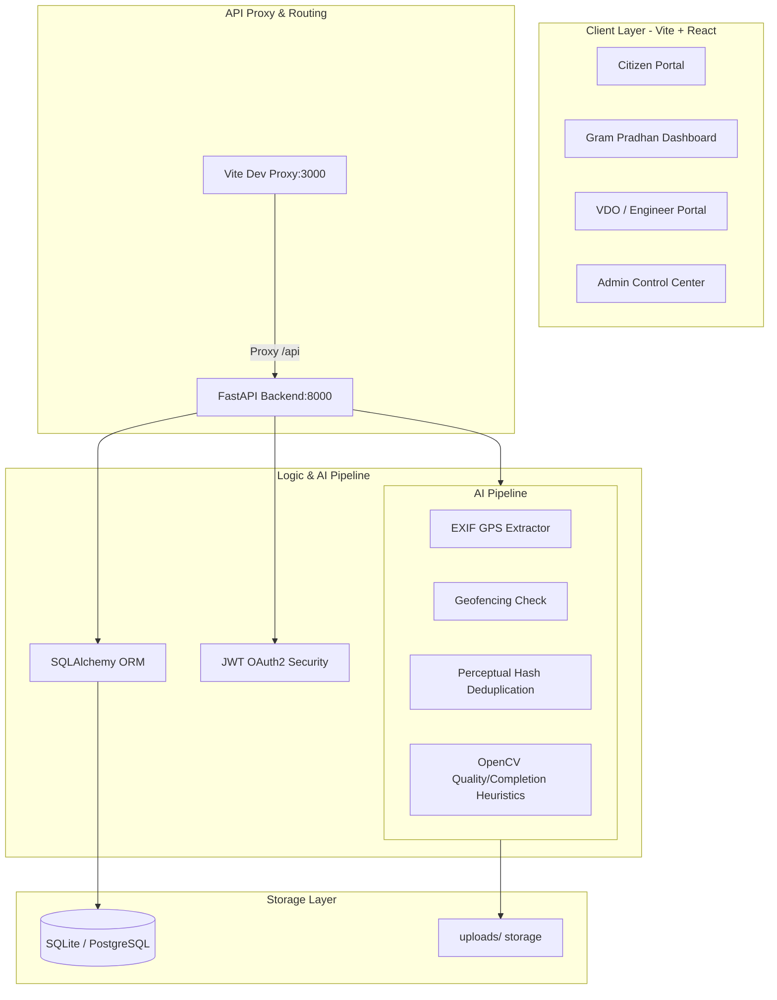

# CivicPulse 🏛

[](https://fastapi.tiangolo.com)
[](https://react.dev)
[](https://tailwindcss.com)
[](https://www.docker.com)
[](https://opensource.org/licenses/MIT)

**AI-Based Public Works Monitoring & Verification System**  
*Mini Project ID: `2024MP_CSEPID077` · Department of Computer Science & Engineering · ABES Institute of Technology*

CivicPulse is a full-stack platform designed to eliminate false completion claims, measurement fraud, and quality gaps in public works projects (roads, drains, buildings) across Municipal Corporations and Gram Panchayats. By integrating **AI-driven visual verification**, **geofenced EXIF validation**, **perceptual hash deduplication**, and **multi-role crowdsourced verification**, it establishes a transparent and auditable record of public work progress.

---

## 🏗 System Architecture & Workflow



---

## 🛠 Tech Stack

- **Frontend & PWA:** React 18, Vite, TypeScript, TailwindCSS, Web Workers, IndexedDB Offline Store, Web App Manifest
- **Backend & Real-Time:** FastAPI (Python 3.12+), WebSocket Multiplexing, OpenTelemetry APM Tracing
- **Database & High-Scale:** PostgreSQL 16 (16-Way Hash Partitioning on `votes`), Async SQLAlchemy 2.0, PgBouncer SCRAM-SHA-256, Dual Redis 7 (Cache + Streams), PostGIS Spatial Geofencing
- **AI/ML & Vision:** Gemini Vision Multimodal AI, OpenCV, Laplacian Edge Blur Variance, GLCM Texture & Material Classification, Perceptual Hash (pHash)
- **Security & Cryptography:** Deterministic SHA-256 Block Chaining, HMAC Digital Signatures, Binary Merkle Tree Verification
- **Load Testing & DevOps:** Locust (10,000+ QPS), k6, Docker Compose Multi-Container Cluster

---

## 👥 User Roles & Permissions

| Role | Permissions | Responsibilities |
|---|---|---|
| **Citizen** | Read-Only Map/Grid, Create Vote, Upload Geotagged Photo | View nearby projects, report issues, vote on completion |
| **Gram Pradhan** | Read/Update Project Status, Create Review Decision | First-line project approval, submit official remarks |
| **VDO / Engineer** | Read/Update Project, Upload Technical Inspection | Quality/measurement verification, final technical sign-off |
| **Admin**| Full CRUD on Users, Projects, Evidence, Global Config | Manage platform permissions, monitor global system analytics |

---

## 🚀 Quick Start

### Prerequisites
- Python 3.10+
- Node.js 20+
- Git

### 1. Clone the repository
```bash
git clone https://github.com/yashmishra/CivicPulse-API.git
cd CivicPulse-API
```

### 2. Run with Makefile
Using the provided `Makefile` at the root, you can start everything in one command:
```bash
make install      # Install all python & npm dependencies
make seed         # Build and seed database with 4 users and 6 projects
make dev          # Run frontend (3000) and backend (8000) concurrently
```

Alternatively, run manually:
```bash
# Terminal 1: Backend
cd backend
python -m app.db.seed
python -m uvicorn app.main:app --reload --port 8000

# Terminal 2: Frontend
cd frontend
npm run dev
```

---

## 📁 Repository Structure

```
civicpulse/
├── backend/                       # FastAPI application service
│   ├── app/
│   │   ├── api/                   # Router endpoints (auth, projects, evidence, etc.)
│   │   ├── core/                  # Configurations, dependencies, security definitions
│   │   ├── db/                    # SQLAlchemy models, database setup, and seed script
│   │   ├── services/              # AI verification pipeline modules (exif, dedupe, vision)
│   │   └── main.py                # App instance & routing registration
│   ├── uploads/                   # Stored evidence images
│   ├── requirements.txt           # Python packages
│   └── Dockerfile                 # Backend container definition
├── frontend/                      # React SPA client
│   ├── src/
│   │   ├── api/                   # API modular client layers
│   │   ├── components/            # UI components (shadcn, layout, widgets)
│   │   ├── pages/                 # Routing pages (Dashboard, Projects, SiteMap, etc.)
│   │   └── lib/                   # Shared utility modules (data.ts, utils.ts)
│   ├── package.json               # NPM packages
│   └── Dockerfile                 # Frontend multi-stage build container
├── docker-compose.yml             # Local multi-container development configuration
├── Makefile                       # Development script shortcut definitions
└── README.md                      # High-level overview
```

---

## ⚙ Demo Credentials

Seeded accounts for dashboard validation:

| Role | Email | Password |
|---|---|---|
| **Admin** | `admin@civicpulse.gov.in` | `Admin@1234` |
| **VDO / Engineer** | `engineer@civicpulse.gov.in` | `Engineer@1234` |
| **Gram Pradhan** | `pradhan@civicpulse.gov.in` | `Pradhan@1234` |
| **Citizen** | `citizen@civicpulse.gov.in` | `Citizen@1234` |

---

## ⚖ License
Distributed under the MIT License. See `LICENSE` for details.
